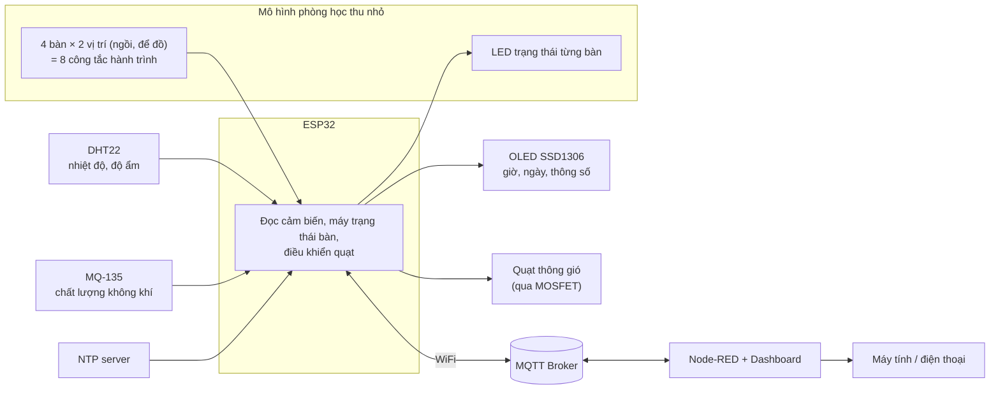
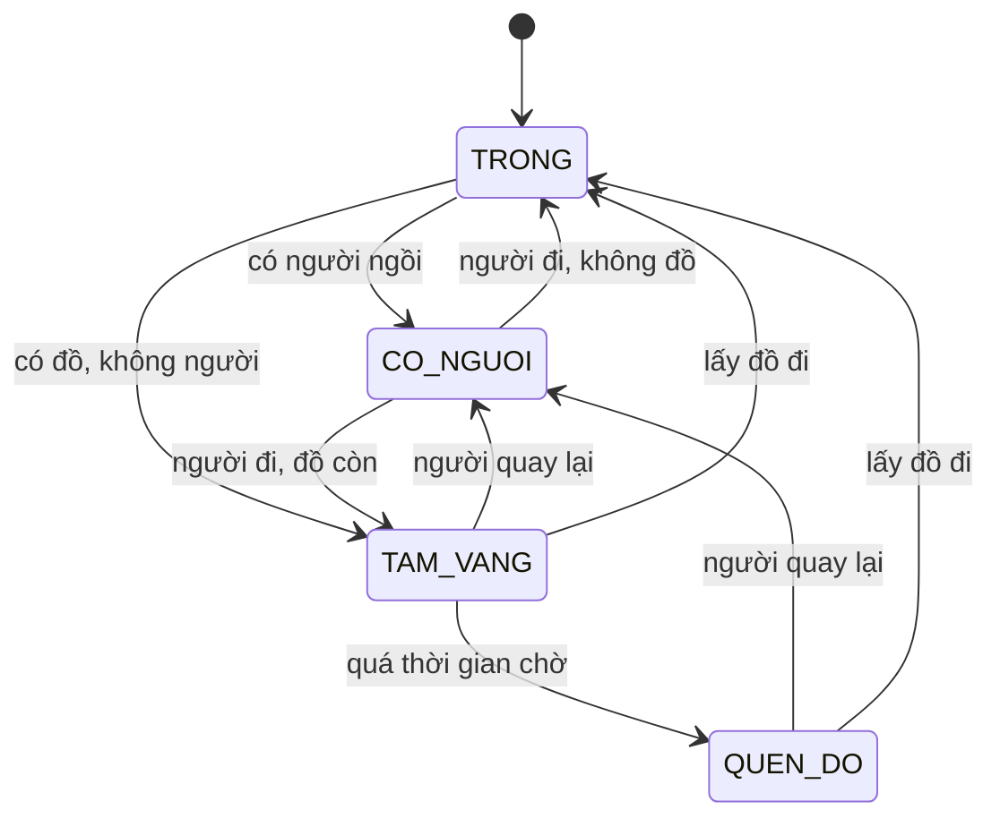
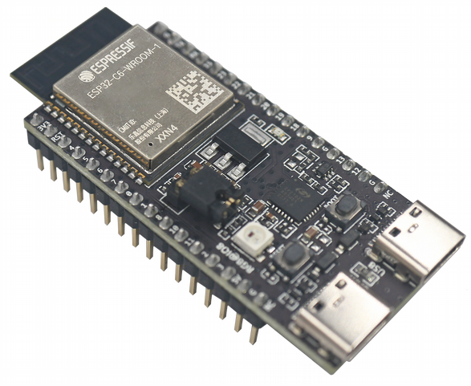
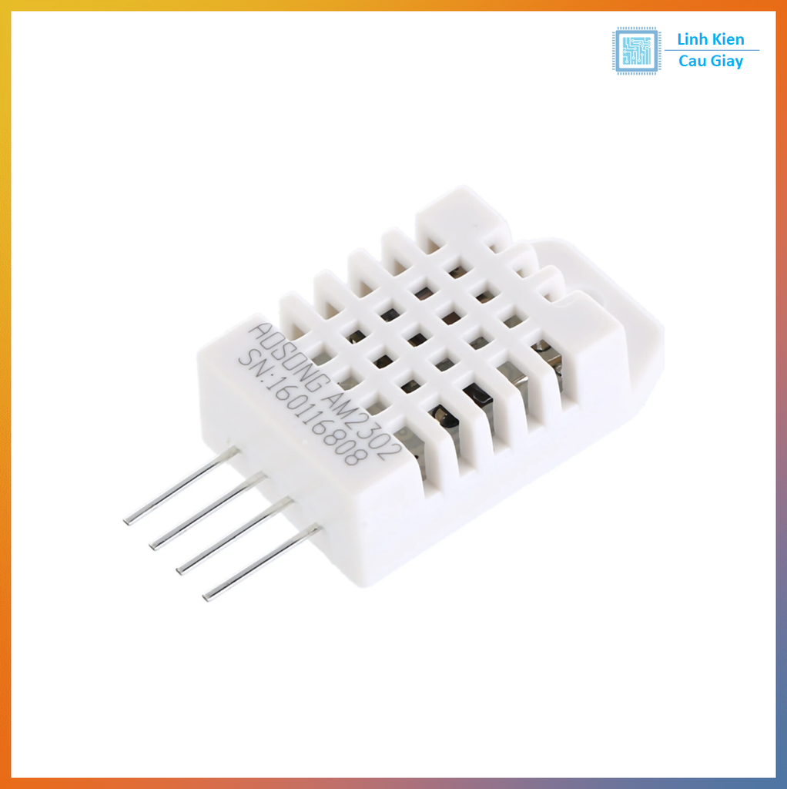
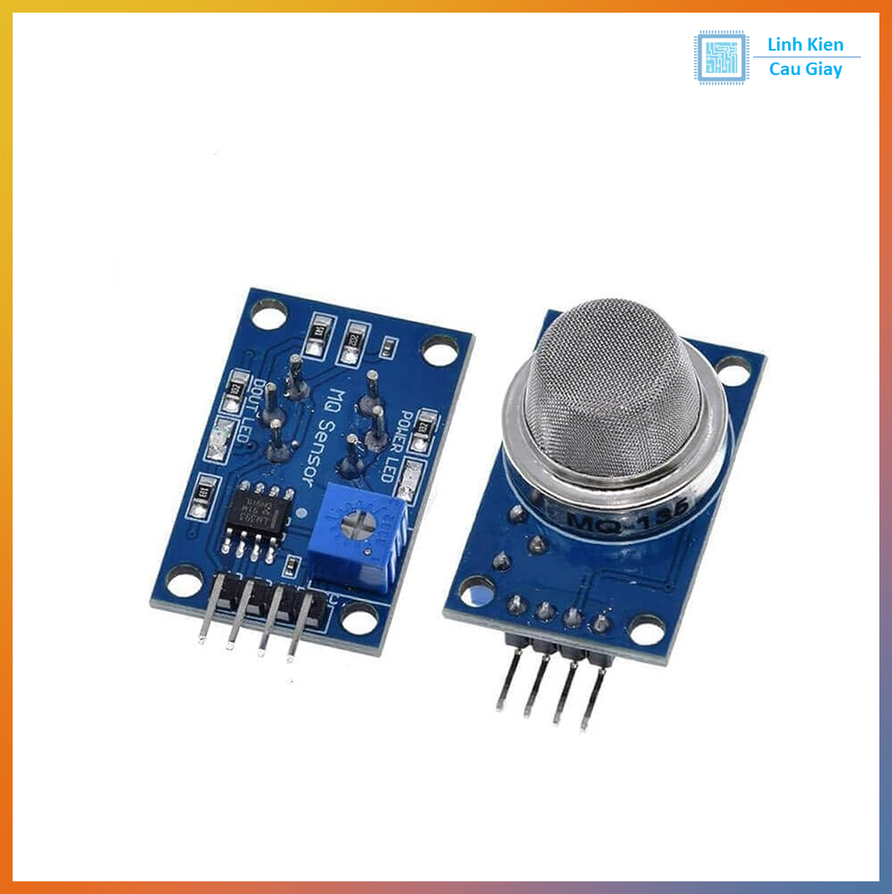
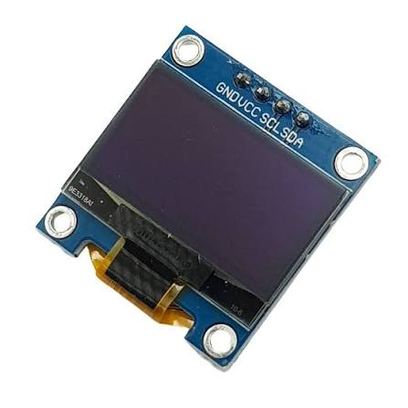
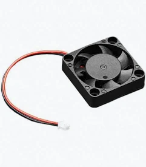
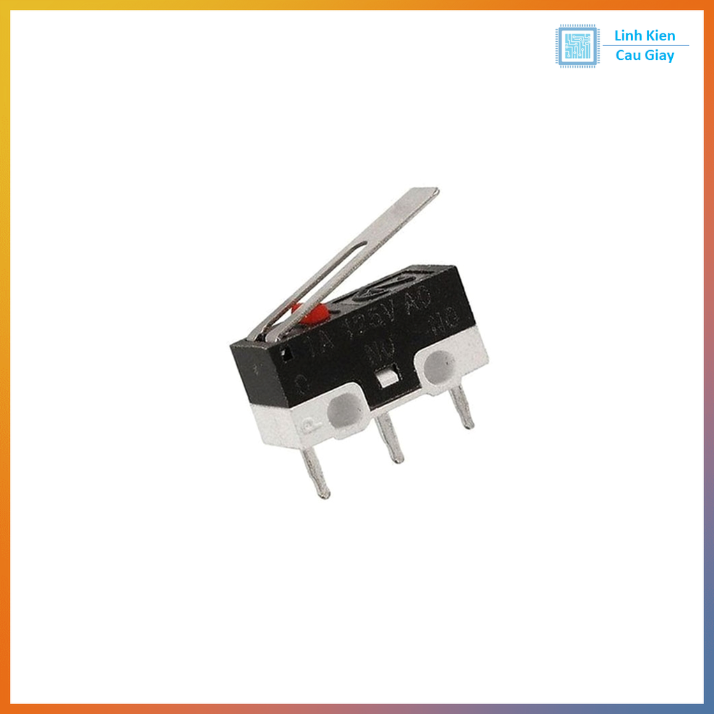
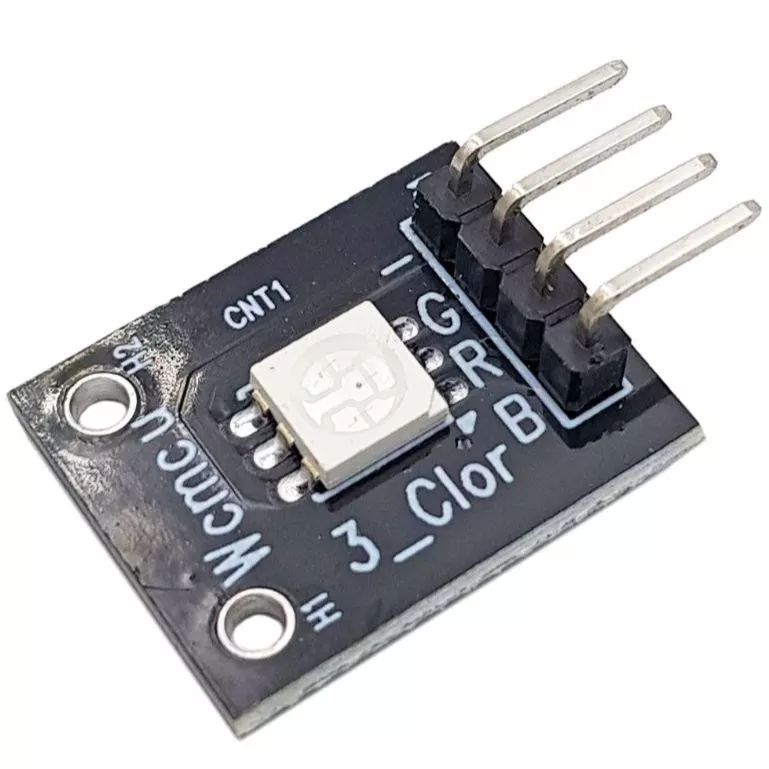

# Phòng tự học thông minh: giám sát chất lượng không khí và phát hiện đồ bỏ quên

> IoT Apps Dev · ESP32 · MQTT · Node-RED Dashboard · PlatformIO

- **Sinh viên thực hiện:** Nguyễn Doãn Bình – 23001582
- **Giảng viên hướng dẫn:** Nguyễn Anh Tuấn

---

## 1. Giới thiệu

Đề tài xây dựng hệ thống IoT trên mô hình phòng tự học thu nhỏ gồm 4 bàn, thực hiện đồng thời hai chức năng:

1. **Giám sát môi trường:** đo nhiệt độ, độ ẩm và chỉ số chất lượng không khí; hiển thị luân phiên cùng ngày giờ trên màn hình OLED; tự động bật quạt thông gió khi chất lượng không khí vượt ngưỡng cho phép.
2. **Phát hiện đồ bỏ quên:** mỗi bàn được trang bị hai cảm biến độc lập xác định "có người" và "có đồ". Khi bàn có đồ nhưng không có người vượt quá thời gian chờ cấu hình, hệ thống chuyển sang trạng thái **"Quên đồ"** và hiển thị cảnh báo trên bản đồ phòng tại dashboard.

Dữ liệu được trao đổi qua giao thức **MQTT** (broker công khai) và được giám sát, điều khiển từ xa bằng **Node-RED Dashboard** trên máy tính và điện thoại.

## 2. Đặt vấn đề

**Chất lượng không khí trong không gian kín.** Phòng tự học thường đóng kín, sử dụng điều hòa và có mật độ người cao, khiến nồng độ khí CO₂ và các chất gây ô nhiễm tăng nhanh, làm giảm sự tỉnh táo và hiệu quả học tập. Người sử dụng thường chỉ nhận biết khi đã xuất hiện triệu chứng mệt mỏi.

**Đồ bỏ quên.** Người học thường để lại sách vở, tư trang trên bàn khi rời phòng. Đồ để lại không có người trông coi trong thời gian dài có nguy cơ thất lạc hoặc mất cắp, đồng thời người quản lý khó phát hiện kịp thời do không có thông tin khách quan về tình trạng từng bàn.

**Hướng giải quyết.** Sử dụng cảm biến để thu thập hai nhóm thông tin khách quan: điều kiện môi trường của phòng và tình trạng từng bàn (có người, có đồ). Thông tin được cung cấp từ xa cho người quản lý và sinh viên, trong khi việc thông gió được thiết bị tự động xử lý.

## 3. Mục tiêu và phạm vi

**Mục tiêu**
- Đo và hiển thị nhiệt độ, độ ẩm, chất lượng không khí theo thời gian thực.
- Điều khiển quạt theo ngưỡng, hỗ trợ hai chế độ Auto và Manual.
- Xác định trạng thái từng bàn (Trống, Có người, Tạm vắng, Quên đồ) và hiển thị trên bản đồ phòng.
- Điều khiển và cấu hình thông số (ngưỡng không khí, thời gian chờ) từ xa qua Node-RED.

**Phạm vi**
- Mô hình thu nhỏ gồm 4 bàn; cấu trúc topic MQTT theo từng bàn cho phép mở rộng số lượng bàn.
- Chỉ số chất lượng không khí mang tính tương đối, không thay thế thiết bị đo chuẩn.
- Hệ thống đánh giá dựa trên thời gian đồ bị để lại mà không có người; các trường hợp người dùng chủ ý để đồ tạm thời được xử lý bằng cách cấu hình thời gian chờ phù hợp.

## 4. Kiến trúc hệ thống



## 5. Phần cứng

| Linh kiện | Vai trò |
|---|---|
| ESP32 DevKit | Xử lý, kết nối WiFi, MQTT |
| DHT22 | Đo nhiệt độ, độ ẩm |
| MQ-135 | Đo chỉ số chất lượng không khí tương đối |
| OLED SSD1306 128×64 (I2C) | Hiển thị giờ, ngày, thông số |
| Quạt 5V + MOSFET + diode | Thông gió |
| 8 công tắc hành trình | Mỗi bàn: 1 vị trí ngồi, 1 vị trí để đồ |
| 4 LED (hoặc LED RGB/WS2812B) | Hiển thị trạng thái từng bàn |

**Chi phí dự kiến:** khoảng 300–400 nghìn đồng (chưa gồm ESP32).

**Quy ước trong mô hình thu nhỏ**
- "Người" được mô phỏng bằng nhân vật mô hình có thêm tải trọng để đủ lực nhấn công tắc tại vị trí ngồi.
- "Đồ" được mô phỏng bằng vật nhỏ (khối giấy cứng, sách mô hình) đặt tại vị trí để đồ.
- Khi triển khai thực tế, thay bằng cảm biến áp lực ở ghế và cảm biến phù hợp tại vị trí để đồ; phần mềm giữ nguyên.

## 6. Nguyên lý hoạt động

### 6.1. Giám sát môi trường, điều khiển quạt và hiển thị

- DHT22 và MQ-135 được đọc theo chu kỳ 2–5 giây, giá trị được làm mượt bằng trung bình trượt.
- Giá trị MQ-135 được quy đổi thành chỉ số 0–100 và phân loại thành ba mức: Tốt, Trung bình, Kém.
- **Điều khiển quạt có trễ (hysteresis):** quạt bật khi chỉ số vượt ngưỡng trên và chỉ tắt khi xuống dưới ngưỡng dưới, tránh đóng ngắt liên tục. Các ngưỡng ban đầu là giá trị dự kiến, sẽ được hiệu chỉnh qua thực nghiệm.
- **OLED hiển thị luân phiên** bằng `millis()` (không dùng `delay()`), mỗi trang 4–5 giây:
  1. Giờ và ngày (đồng bộ NTP, múi giờ UTC+7)
  2. Nhiệt độ và độ ẩm
  3. Chất lượng không khí và trạng thái quạt
  4. Tóm tắt trạng thái các bàn

### 6.2. Máy trạng thái của bàn

Mỗi bàn có hai đầu vào số: **có người** (công tắc tại vị trí ngồi) và **có đồ** (công tắc tại vị trí để đồ). Tín hiệu được lọc nhiễu tiếp điểm (debounce) và có độ trễ ngắn để việc đứng dậy trong thời gian ngắn không bị coi là rời đi.

| Trạng thái | Điều kiện | Màu LED |
|---|---|---|
| Trống | Không đồ, không người | Xanh lá |
| Có người | Có người ngồi | Xanh dương |
| Tạm vắng | Có đồ, không người, chưa quá thời gian chờ | Vàng |
| Quên đồ | Có đồ, không người, đã quá thời gian chờ | Đỏ |



**Thời gian chờ** được cấu hình từ Node-RED: 30 giây khi trình diễn, khoảng 20 phút khi sử dụng thực tế.

## 7. Giao tiếp MQTT

Hệ thống sử dụng broker công khai (HiveMQ hoặc EMQX). Do broker công khai không giới hạn truy cập, tất cả topic dùng tiền tố riêng có dạng `<tiền_tố>/studyroom/...`.

| Topic | Hướng | Nội dung |
|---|---|---|
| `.../room/env` | ESP32 → Node-RED | JSON: nhiệt độ, độ ẩm, chỉ số không khí |
| `.../room/fan/state` | ESP32 → Node-RED | Trạng thái và chế độ của quạt |
| `.../room/fan/cmd` | Node-RED → ESP32 | `auto` / `on` / `off` |
| `.../desk/<id>/state` | ESP32 → Node-RED | JSON: có đồ, có người, trạng thái, thời gian chờ |
| `.../config/timeout` | Node-RED → ESP32 | Thời gian chờ (giây) |
| `.../config/air_threshold` | Node-RED → ESP32 | Ngưỡng bật/tắt quạt |
| `.../status` | ESP32 → Node-RED | `online` / `offline` (Last Will and Testament) |

Ví dụ bản tin (dự kiến):

```json
// .../room/env
{ "temp": 29.4, "hum": 68, "air": 52, "air_level": "medium" }

// .../desk/2/state
{ "item": true, "person": false, "state": "AWAY", "wait_s": 840 }
```

## 8. Dashboard Node-RED

- **Bản đồ phòng:** lưới 4 bàn xây dựng bằng `ui_template` (HTML/CSS), đổi màu theo bốn trạng thái ở mục 6.2.
- **Môi trường:** biểu đồ nhiệt độ, độ ẩm và chỉ số không khí theo thời gian.
- **Điều khiển:** công tắc Auto/Manual cho quạt; thanh trượt chỉnh ngưỡng không khí và thời gian chờ.
- **Nhật ký sự kiện:** ghi nhận các chuyển trạng thái (ví dụ: "Bàn 2 chuyển sang Quên đồ lúc 14:32").
- **Trạng thái thiết bị:** online/offline.
- *Mở rộng:* thống kê số lần phát hiện quên đồ theo bàn và theo thời gian; thông báo qua Telegram.

## 9. Đóng góp và tính ứng dụng

- Tích hợp giám sát môi trường và phát hiện đồ bỏ quên trong một hệ thống, đáp ứng nhu cầu thực tế của phòng tự học và thư viện.
- Dùng hai cảm biến độc lập (người, đồ) thay vì cảm biến chuyển động đơn thuần, tránh báo nhầm khi người học ngồi yên.
- Tăng độ ổn định hệ thống bằng điều khiển quạt có trễ và lọc nhiễu tiếp điểm.
- Trao đổi dữ liệu hai chiều qua MQTT: dữ liệu cảm biến lên dashboard, lệnh điều khiển và cấu hình xuống thiết bị.

## 10. Công cụ và môi trường phát triển

- **Lập trình:** PlatformIO, Arduino framework (ESP32)
- **Thư viện:** PubSubClient (MQTT), DHT sensor library, Adafruit SSD1306 và GFX, ArduinoJson
- **Mô phỏng:** Wokwi
- **Giám sát và điều khiển:** Node-RED, node-red-dashboard
- **Đồng bộ thời gian:** NTP, múi giờ UTC+7

## 11. Kế hoạch thực hiện

| Giai đoạn | Nội dung |
|---|---|
| 1 | Mô phỏng trên Wokwi: DHT22, MQ-135 (hoặc biến trở), OLED, quạt, nút nhấn thay công tắc |
| 2 | Kết nối WiFi, MQTT, NTP; OLED luân phiên; quạt Auto/Manual |
| 3 | Máy trạng thái 4 bàn, debounce, LED trạng thái, gửi dữ liệu MQTT |
| 4 | Node-RED: bản đồ phòng, biểu đồ, điều khiển, nhật ký |
| 5 | Lắp mô hình thực, hiệu chỉnh ngưỡng, kiểm thử, quay video trình diễn |

## 12. Hình ảnh linh kiện

<table>
  <tr>
    <td align="center"><br><sub><b>Hình 1.</b> Vi điều khiển ESP32</sub></td>
    <td align="center"><br><sub><b>Hình 2.</b> Cảm biến DHT22</sub></td>
    <td align="center"><br><sub><b>Hình 3.</b> Cảm biến MQ-135</sub></td>
    <td align="center"><br><sub><b>Hình 4.</b> Màn hình OLED SSD1306</sub></td>
  </tr>
  <tr>
    <td align="center"><br><sub><b>Hình 5.</b> Quạt thông gió</sub></td>
    <td align="center"><br><sub><b>Hình 6.</b> Công tắc hành trình</sub></td>
    <td align="center"><br><sub><b>Hình 7.</b> LED trạng thái</sub></td>
    <td></td>
  </tr>
</table>

## 13. Tài liệu tham khảo

1. Random Nerd Tutorials, [ESP32 MQTT Publish/Subscribe with Node-RED](https://randomnerdtutorials.com/esp32-mqtt-publish-subscribe-arduino-ide/)
2. Hackaday.io, [Project Aura: Open-Source ESP32 Air Quality](https://hackaday.io/project/204993-project-aura-open-source-esp32-air-quality)
3. [Wokwi – ESP32 Simulator](https://wokwi.com)
4. [Node-RED](https://nodered.org)
