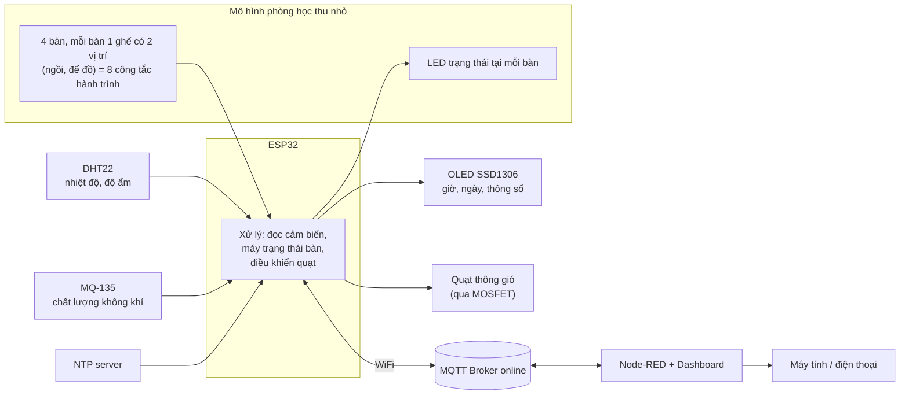
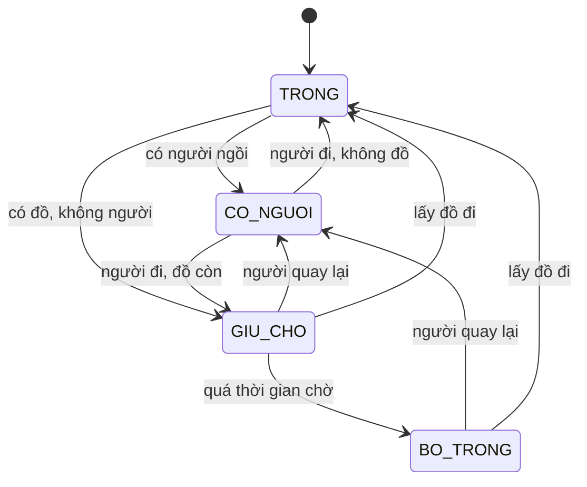

# Phòng tự học thông minh: giám sát không khí và chống giữ chỗ ảo

> Đồ án môn IoT – ESP32 · MQTT · Node-RED Dashboard · PlatformIO

- **Sinh viên:** Nguyễn Doãn Bình – 23001582
- **Giảng viên:** [Tên giảng viên]

---

## 1. Tóm tắt ý tưởng

Mô hình **phòng học thu nhỏ** gồm 4 bàn, kèm hệ thống IoT có hai chức năng chạy song song:

1. **Giám sát môi trường:** đo nhiệt độ, độ ẩm và chất lượng không khí, hiển thị luân phiên cùng ngày giờ trên màn OLED. Khi không khí không đảm bảo, quạt tự bật.
2. **Chống giữ chỗ ảo:** mỗi bàn có cảm biến phát hiện "có người" và "có đồ". Nếu bàn có đồ mà không có người trong một khoảng thời gian dài, hệ thống báo trạng thái **"Bỏ trống?"** và hiển thị trên **bản đồ phòng** ở dashboard.

Dữ liệu trao đổi qua **MQTT** (broker online), theo dõi và điều khiển bằng **Node-RED Dashboard** trên máy tính và điện thoại.

## 2. Đặt vấn đề

**Vấn đề 1 – Không khí trong phòng kín.** Phòng tự học, phòng ôn thi thường đóng cửa và bật điều hòa, đông người nên không khí nhanh ngột ngạt, gây buồn ngủ và giảm tập trung. Người trong phòng thường không nhận ra cho đến khi đã mệt.

**Vấn đề 2 – Giữ chỗ ảo.** Vào mùa thi, nhiều bạn để sách vở, túi xách lên ghế rồi đi rất lâu. Bàn trông như có người nhưng thực tế bỏ trống, trong khi những bạn đến sau không có chỗ ngồi và không ai biết bàn nào thật sự đang được dùng.

**Hướng giải quyết.** Dùng cảm biến để biết hai điều khách quan: môi trường phòng đang thế nào, và bàn nào đang được dùng thật. Người quản lý và sinh viên xem được tình trạng phòng từ xa, còn thiết bị tự xử lý phần thông gió.

## 3. Mục tiêu và phạm vi

**Mục tiêu**
- Đo và hiển thị nhiệt độ, độ ẩm, chất lượng không khí theo thời gian thực.
- Tự bật/tắt quạt theo ngưỡng, có chế độ Auto/Manual.
- Phát hiện trạng thái từng bàn (Trống, Có người, Giữ chỗ, Bỏ trống?) và hiển thị bản đồ phòng.
- Điều khiển và cấu hình (ngưỡng, thời gian chờ) từ xa qua Node-RED.

**Phạm vi**
- Mô hình thu nhỏ 4 bàn. Thiết kế có thể mở rộng thêm bàn nhờ cấu trúc topic MQTT theo từng bàn.
- Chất lượng không khí là chỉ số tương đối, không phải thiết bị đo chuẩn.

## 4. Sơ đồ khối hệ thống



## 5. Phần cứng dự kiến

| Thành phần | Linh kiện | Vai trò | Ghi chú |
|---|---|---|---|
| Vi điều khiển | ESP32 DevKit | Xử lý, WiFi, MQTT | Đã có sẵn |
| Nhiệt độ, độ ẩm | DHT22 | Đo môi trường | |
| Chất lượng không khí | MQ-135 | Chỉ số không khí tương đối | Cần làm nóng, chia áp trước khi vào ADC, đọc bằng ADC1 |
| Hiển thị | OLED SSD1306 128x64 (I2C) | Giờ, ngày, thông số | |
| Thực thi | Quạt 5V + MOSFET/transistor + diode | Thông gió | Không cấp trực tiếp từ chân GPIO |
| Cảm biến bàn ghế | 8 công tắc hành trình (cần gạt dài) | Mỗi bàn: 1 cho vị trí ngồi, 1 cho vị trí để đồ | Có tấm đệm nhỏ phủ lên công tắc |
| Báo trạng thái | 4 LED (hoặc LED RGB/WS2812B) | Trạng thái từng bàn | Có thể thêm buzzer |

**Dự toán:** khoảng 300–400k (ước tính, ESP32 đã có sẵn).

**Quy ước trong mô hình thu nhỏ**
- "Người" là một nhân vật mô hình nhỏ đặt lên vị trí ngồi, có thêm vật nặng để đủ nhấn công tắc.
- "Đồ" là vật nhỏ (khối giấy cứng, sách mô hình) đặt lên vị trí để đồ trên ghế.
- Khi áp dụng cho phòng thật, thay bằng cảm biến áp lực ở ghế và cảm biến phù hợp ở chỗ để đồ, phần mềm giữ nguyên.

## 6. Nguyên lý hoạt động

### 6.1. Môi trường, quạt và màn OLED
- Đọc DHT22 và MQ-135 theo chu kỳ (ví dụ 2–5 giây), làm mượt giá trị bằng trung bình trượt.
- Quy đổi giá trị MQ-135 thành chỉ số 0–100 và phân loại: Tốt, Trung bình, Kém.
- **Quạt có hysteresis:** bật khi chỉ số vượt ngưỡng trên, chỉ tắt khi xuống dưới ngưỡng thấp hơn, tránh bật tắt liên tục. Ngưỡng ban đầu là giá trị dự kiến, sẽ hiệu chỉnh khi thử thực tế.
- **OLED luân phiên** bằng `millis()` (không dùng `delay()`), mỗi trang hiển thị 4–5 giây:
  1. Giờ và ngày (đồng bộ NTP, múi giờ UTC+7)
  2. Nhiệt độ và độ ẩm
  3. Chất lượng không khí và trạng thái quạt
  4. Tóm tắt bàn (ví dụ: 2 có người, 1 giữ chỗ, 1 bỏ trống?)

### 6.2. Trạng thái từng bàn

Mỗi bàn có hai đầu vào số: **có người** (công tắc ở vị trí ngồi) và **có đồ** (công tắc ở vị trí để đồ). Có debounce để tránh nhiễu tiếp điểm, và có thêm độ trễ ngắn để người đứng dậy vài giây không bị tính là đã đi.

| Trạng thái | Điều kiện | Màu LED |
|---|---|---|
| Trống | Không đồ, không người | Xanh lá |
| Có người | Đang có người ngồi | Xanh dương |
| Giữ chỗ | Có đồ, không người, chưa quá thời gian chờ | Vàng |
| Bỏ trống? | Có đồ, không người, đã quá thời gian chờ | Đỏ |



**Thời gian chờ** chỉnh được từ Node-RED: khi demo đặt 30 giây, khi dùng thực tế khoảng 20 phút.

## 7. Giao tiếp MQTT

Dùng broker online công khai (ví dụ HiveMQ hoặc EMQX public). Vì broker công khai ai cũng đọc được, mọi topic có tiền tố riêng: `<tiền_tố_của_bạn>/studyroom/...`.

| Topic | Hướng | Nội dung |
|---|---|---|
| `.../room/env` | ESP32 → Node-RED | JSON nhiệt độ, độ ẩm, chỉ số không khí |
| `.../room/fan/state` | ESP32 → Node-RED | Trạng thái quạt và chế độ hiện tại |
| `.../room/fan/cmd` | Node-RED → ESP32 | `auto` / `on` / `off` |
| `.../desk/<id>/state` | ESP32 → Node-RED | JSON: có đồ, có người, trạng thái, số giây chờ |
| `.../config/timeout` | Node-RED → ESP32 | Thời gian chờ (giây) |
| `.../config/air_threshold` | Node-RED → ESP32 | Ngưỡng bật/tắt quạt |
| `.../status` | ESP32 → Node-RED | `online` / `offline` (dùng LWT) |

Ví dụ dữ liệu (dự kiến):

```json
// .../room/env
{ "temp": 29.4, "hum": 68, "air": 52, "air_level": "medium" }

// .../desk/2/state
{ "item": true, "person": false, "state": "HOLD", "wait_s": 840 }
```

## 8. Dashboard Node-RED

- **Bản đồ phòng:** lưới 4 bàn vẽ bằng `ui_template` (HTML/CSS), mỗi bàn đổi màu theo 4 trạng thái ở mục 6.2.
- **Môi trường:** gauge hoặc biểu đồ nhiệt độ, độ ẩm, chỉ số không khí theo thời gian.
- **Điều khiển:** công tắc Auto/Manual cho quạt; slider chỉnh ngưỡng không khí và thời gian chờ.
- **Nhật ký sự kiện:** ví dụ "Bàn 2 chuyển sang Bỏ trống? lúc 14:32".
- **Trạng thái thiết bị:** online/offline.
- Tùy chọn: thông kê bàn dùng thật so với giữ chỗ, thông báo Telegram.

## 9. Điểm sáng tạo và tính ứng dụng

- Kết hợp hai bài toán (môi trường và quản lý chỗ ngồi) trong một hệ thống, giải quyết nhu cầu thật của phòng tự học và thư viện.
- Phát hiện "có đồ mà không có người" bằng hai cảm biến độc lập thay vì chỉ cảm biến chuyển động, tránh báo nhầm khi người ngồi yên học.
- Quạt có hysteresis, cảm biến có debounce để hệ thống ổn định.
- Hai chiều dữ liệu qua MQTT: cảm biến lên dashboard, lệnh và cấu hình xuống thiết bị.

## 10. Công cụ và môi trường

- **Lập trình:** PlatformIO + Arduino framework (ESP32)
- **Thư viện dự kiến:** PubSubClient (MQTT), DHT sensor library, Adafruit SSD1306 + GFX, ArduinoJson
- **Mô phỏng và debug:** Wokwi
- **Giám sát và điều khiển:** Node-RED + node-red-dashboard
- **Đồng bộ thời gian:** NTP, múi giờ UTC+7

## 11. Kế hoạch thực hiện

| Giai đoạn | Nội dung |
|---|---|
| 1 | Mô phỏng Wokwi: DHT22, MQ-135 (hoặc biến trở), OLED, quạt, nút nhấn thay công tắc |
| 2 | WiFi, MQTT, NTP; OLED luân phiên; quạt Auto/Manual |
| 3 | Máy trạng thái 4 bàn, debounce, LED trạng thái, gửi MQTT |
| 4 | Node-RED: bản đồ phòng, biểu đồ, điều khiển, nhật ký |
| 5 | Lắp mô hình thật, hiệu chỉnh ngưỡng, kiểm thử, quay video demo |

## 12. Hình ảnh phần cứng dự kiến

<!-- Thay các dòng dưới bằng ảnh thật, ví dụ:  -->
- ESP32 và các cảm biến dự kiến: `[chèn ảnh]`
- Công tắc hành trình dùng cho bàn ghế: `[chèn ảnh]`
- Sơ đồ nối dây (xuất từ Wokwi): `[chèn ảnh]`
- Phác thảo mô hình phòng học thu nhỏ: `[chèn ảnh]`
- Mockup dashboard bản đồ phòng: `[chèn ảnh]`

## 13. Tài liệu tham khảo

- Random Nerd Tutorials – [ESP32 MQTT publish/subscribe với Node-RED](https://randomnerdtutorials.com/esp32-mqtt-publish-subscribe-arduino-ide/)
- Hackaday.io – [Project Aura: Open-Source ESP32 Air Quality](https://hackaday.io/project/204993-project-aura-open-source-esp32-air-quality) (cảm hứng cho phần giám sát không khí)
- [Wokwi – mô phỏng ESP32](https://wokwi.com)
- [Node-RED](https://nodered.org)
- [Hackaday](https://hackaday.com) – nguồn cảm hứng chung cho dự án IoT
